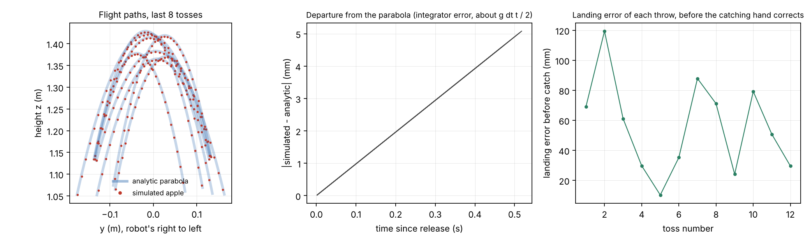

# Unitree G1 Apple Toss Simulation

**A MuJoCo-based humanoid robot simulation demonstrating an apple being tossed from one hand to the other using projectile motion, inverse kinematics, and robotic arm control.**

## 1. Project Overview

This project simulates a Unitree G1 humanoid robot repeatedly tossing an apple between its left and right hands.

The throwing arm calculates the required release velocity using projectile-motion equations, while the catching arm predicts the apple's landing position and moves to intercept it.

The simulation uses the MuJoCo physics engine to model robot dynamics, apple motion, contacts, and catching.

## 2. Demo Video

The following video demonstrates 12 consecutive apple tosses made using the project code.

[Watch the Apple Toss Demo](apple_toss_demo.mp4)

## 3. Key Features

- **Projectile Motion Planning:** Calculates the release velocity required to reach the opposite hand.
- **Inverse Kinematics:** Controls the robot's seven-joint arms to follow desired hand trajectories.
- **Physics Simulation:** Uses MuJoCo to simulate the robot and apple.
- **Predictive Catching:** Estimates the apple's landing position using its measured position and velocity.
- **Iterative Learning Control:** Uses previous throwing errors to improve subsequent throws.
- **Trajectory Visualization:** Displays the predicted parabola, actual flight path, predicted catch point, and apple velocity.
- **Data Logging:** Records information about each toss in a CSV file.

## 4. How the Simulation Works

Each toss follows five main stages:

1. **Plan:** Projectile-motion equations calculate the release velocity required to reach the opposite hand.
2. **Throw:** Inverse kinematics and torque-limited PD servos control the throwing arm.
3. **Flight:** The apple moves freely under gravity after release.
4. **Catch:** The opposite arm predicts the landing position and moves to intercept the apple.
5. **Learn:** The difference between the planned and achieved release velocity is used to improve the next throw.

## 5. Physics and Mathematical Concepts

The project applies the principles of projectile motion.

The required release velocity is calculated using:

\[
\mathbf{v}_0 =
\frac{\mathbf{p}_{target}-\mathbf{p}_{release}}{T}
+\frac{gT}{2}\hat{\mathbf{z}}
\]

Where:

- \(\mathbf{v}_0\) = required release velocity
- \(\mathbf{p}_{target}\) = target position
- \(\mathbf{p}_{release}\) = apple release position
- \(T\) = desired time of flight
- \(g\) = gravitational acceleration

The simulation compares the analytically predicted trajectory with the trajectory produced by the physics engine.

## 6. Software and Technologies

- Python 3.9 or newer
- MuJoCo
- NumPy
- Matplotlib
- ImageIO
- ImageIO-FFmpeg
- Pillow
- XML model and scene descriptions

## 7. Project Files

| File | Description |
|---|---|
| `apple_toss.py` | Main simulation and robot controller |
| `scene_toss.xml` | MuJoCo scene configuration |
| `g1_with_hands.xml` | Unitree G1 robot model XML |
| `run_apple_toss.bat` | Windows launcher |
| `apple_toss_demo.mp4` | Recorded simulation demonstration |
| `toss_analysis.png` | Graphical analysis of the simulation |
| `toss_log.csv` | Numerical results recorded for each toss |
| `README.txt` | Original project instructions |
| `LICENSE` | License file |

**Robot model assets:** The original project instructions specify a `g1/` directory containing the Unitree G1 model and mesh assets from MuJoCo Menagerie. These assets must be available in the expected location for the simulation to run correctly.

## 8. Installation and Setup

### Requirements

Install Python 3.9 or newer.

Install the required Python packages using:

```bash
pip install mujoco numpy matplotlib imageio imageio-ffmpeg pillow
```

### Running the Simulation on Windows

1. Make sure the required robot model assets are available.
2. Open the project folder.
3. Double-click `run_apple_toss.bat`.
4. The interactive MuJoCo viewer will open.

### Running Through the Terminal

Run the following command from the project directory:

```bash
python apple_toss.py
```

To record a simulation video:

```bash
python apple_toss.py --record my_video.mp4 --tosses 12
```

## 9. Simulation Results

The supplied demonstration contains 12 consecutive tosses, all successfully caught.

The recorded run reports:

- Release speed: approximately 2.0–2.5 m/s
- Time of flight: approximately 0.43–0.52 seconds
- Agreement between measured and predicted flight time: approximately 2 ms
- Agreement between measured and predicted apex height: approximately 2 mm

The numerical results are available in `toss_log.csv`.

### Toss Analysis

The following graph shows the simulated flight paths, deviation from the analytical projectile trajectory, and landing error across tosses.



## 10. Physical Modelling and Simplifications

The simulation includes:

- Rigid-body dynamics of the robot.
- Torque-limited joint servos on the arms.
- Apple motion under gravity.
- Contacts and catching as an interception problem.

Some elements are simplified:

- Grasping is represented using a soft weld constraint between the palm and apple. The fingers open and close visually but do not carry the apple's load.
- The robot's pelvis is held by a virtual support stand. A balance controller is not implemented.

These assumptions are important when interpreting the simulation results.

## 11. Conclusion

The Unitree G1 Apple Toss Simulation demonstrates how projectile-motion equations, inverse kinematics, robotic control, and physics simulation can be combined to achieve a repeated hand-to-hand tossing and catching task.

The project provides a practical example of applying dynamics and control concepts to humanoid robotics using Python and MuJoCo.

---

**Project:** Unitree G1 Apple Toss Simulation  
**Username:** thrishakunala
